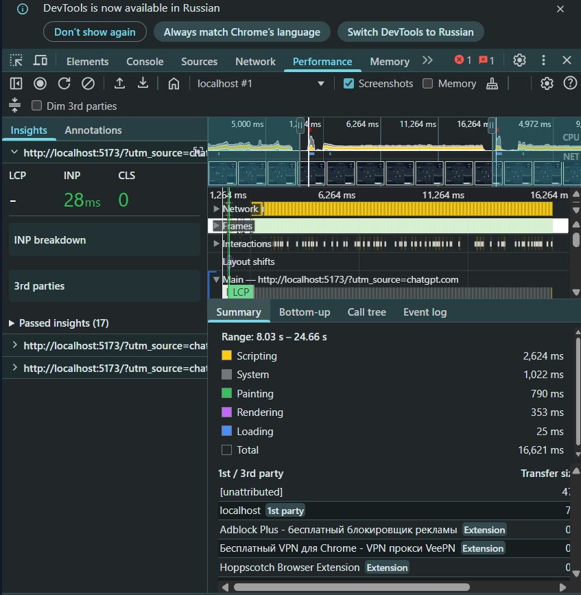
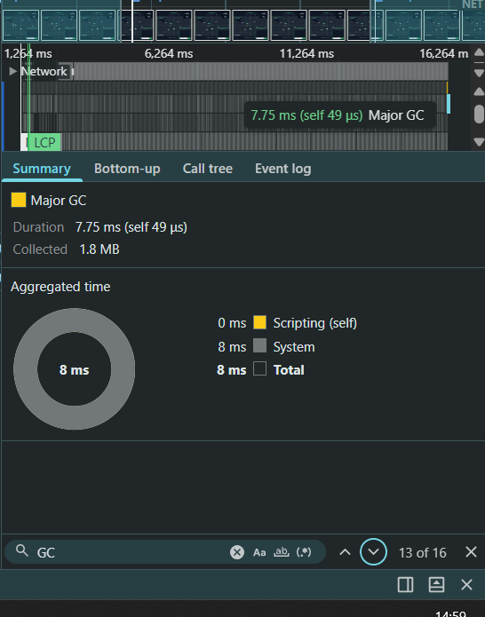
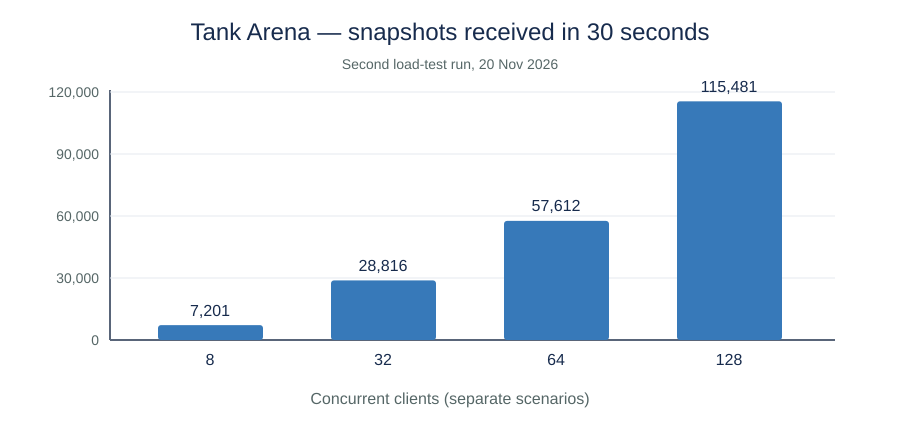

# Лабораторна робота №7 — Продуктивність V8, пам'ять та автоматизоване тестування

**Проєкт:** Tank Arena — багатокористувацька браузерна гра на TypeScript, Canvas, Node.js та WebSocket.  
**Дата вимірювань:** 20.11.2026.

## Мета роботи

Дослідити продуктивність JavaScript/V8, зменшити зайві виділення пам'яті під час симуляції, перевірити плавність кадрів, роботу збирача сміття (GC), навантаження сервера та автоматизовані тести.

## Виконані зміни

- Оптимізовано оновлення координат `Entity` і `Particle`: зміни виконуються на місці замість створення проміжних векторів.
- Реалізовано повторне використання частинок (pool) у симуляції, щоб зменшити кількість короткоживучих об'єктів.
- Додано перевірки продуктивності симуляції, модульні тести Vitest та E2E-сценарій Playwright із двома браузерами.
- Проведено експеримент із Web Worker без інтеграції воркера в основний ігровий цикл.
- Виконано браузерне профілювання, аналіз GC і навантажувальне тестування WebSocket-сервера.
- Додано вимірювання часу синхронного серверного тіку в `server/src/index.ts`.

## Порівняння до та після оптимізації

| Компонент | До | Після | Очікуваний ефект |
|---|---|---|---|
| `Entity.update()` | Створення проміжних об'єктів векторів | Зміна компонентів на місці | Менше алокацій |
| `Particle.update()` | Проміжні об'єкти під час руху | Оновлення координат на місці | Менший тиск на GC |
| Життєвий цикл частинок | Створення нових об'єктів | Повторне використання через pool | Менше короткоживучих об'єктів |
| Серверний тік | Час виконання не записувався | Вимірювання `performance.now()` і p50/p95/p99 | Можливість контролю бюджету 33 мс |
| Навантаження | Не було зафіксованих результатів цих сценаріїв | Сценарії 8/32/64/128 клієнтів | Перевірка масштабування |

> **Примітка:** числових вимірювань *до* оптимізації немає, тому відсоток прискорення не розраховувався. Таблиця порівнює реалізацію, а не вигаданий benchmark.

## Автоматизовані перевірки

| Перевірка | Результат |
|---|---|
| TypeScript (`npm run typecheck`) | Успішно |
| Vitest (`npx vitest run`) | **148/148 тестів**, 5 файлів |
| Production build (`npm run build`) | Успішно |
| Playwright, два браузери (`npx playwright test`) | **1/1 сценарій** успішно (попередній запуск) |
| GitHub Actions | Раніше перевірено успішне виконання CI та typecheck |

## Вимірювання інтервалів між кадрами

Вимірювання виконано у Chrome протягом 30 секунд за допомогою `requestAnimationFrame` з одним гравцем.

| Показник | Запуск №1 | Запуск №2 |
|---|---:|---:|
| Кількість інтервалів | 4 431 | 4 946 |
| p50 | 6,10 мс | 6,10 мс |
| p95 | 6,20 мс | 6,20 мс |
| p99 | 6,40 мс | 6,30 мс |
| Максимум | 3 098,90 мс | 12,20 мс |
| Середня частота | 147,72 FPS | 164,87 FPS |
| Інтервали понад 16,7 мс | 3 | 0 |

Перший запуск містить одиничний великий викид; його причина не встановлена. Другий запуск був стабільнішим. **Це інтервали між викликами `requestAnimationFrame`, а не безпосередній час виконання рендеру.** Тест з одним гравцем не замінює перевірку з вісьмома ботами.

## Профілювання Chrome DevTools

У вибраному фрагменті запису тривалістю **16,62 с** Chrome DevTools показав: Scripting — **2 624 мс**, Painting — **790 мс**, Rendering — **353 мс**, INP — **28 мс**, CLS — **0**. Значення Scripting/Painting/Rendering — сумарний час активностей, а не тривалість одного кадру.



*Рисунок 1 — Запис Performance у Chrome DevTools.*

### Події збирача сміття

| Подія | Тривалість | Звільнена пам'ять |
|---|---:|---:|
| Minor GC | 1,80 мс | 1,3 МБ |
| Minor GC | 1,55 мс | 862 КБ |
| Minor GC | 1,61 мс | 1,5 МБ |
| Minor GC | 1,57 мс | 753 КБ |
| Major GC | **7,75 мс** | 1,8 МБ |
| C++ GC | 0,033 мс | Не вказано |
| C++ GC | 0,022 мс | Не вказано |

Найдовша **підтверджена серед переглянутих** GC-подія — Major GC тривалістю 7,75 мс. Це не є доказом максимального часу GC за весь запис.



*Рисунок 2 — Подія Major GC (7,75 мс).*

## Експеримент із Web Worker

| Метрика | Значення |
|---|---:|
| Обчислення в основному потоці | 105,70 мс |
| Обчислення у Worker | 104,30 мс |
| Повний час Worker з передаванням результату | 137,10 мс |
| Різниця контрольних сум | 0 |

Результати обчислень збіглися, проте повний час роботи Worker був більшим через накладні витрати. Тому Worker залишено як експеримент і не включено до основного ігрового циклу.

## Навантажувальне тестування WebSocket-сервера

Скрипт `scripts/load-test.mjs` створював тестових клієнтів, розподілених між кімнатами по 4 гравці. Кожен сценарій тривав **30 секунд**. Нижче наведено **повторний запуск**.

| Показник | 8 клієнтів | 32 клієнти | 64 клієнти | 128 клієнтів |
|---|---:|---:|---:|---:|
| Успішно підключено | 8 | 32 | 64 | 128 |
| Кімнат | 2 | 8 | 16 | 32 |
| Час підключення всіх, мс | 54 | 53 | 75 | 164 |
| Надісланих команд | 3 896 | 16 294 | 32 817 | 65 664 |
| Отриманих snapshot | 7 201 | 28 816 | 57 612 | 115 481 |
| Помилок | 0 | 0 | 0 | 0 |
| Відключень | 0 | 0 | 0 | 0 |
| p95 затримки event loop тестового клієнта | 10,79 мс | 11,39 мс | 11,47 мс | 10,85 мс |
| p99 затримки event loop тестового клієнта | 11,66 мс | 12,51 мс | 13,38 мс | 16,09 мс |



*Рисунок 3 — Кількість snapshot за 30 секунд залежно від кількості клієнтів.*

**Важливо:** затримка event loop тестового клієнта не є тривалістю серверного тіку. Поле `serverTickP99Ms` у JSON результатів залишалося `null`, тому серверні вимірювання наведено окремо.

### Тривалість серверного тіку

Для одного з інтервалів **300 тіків** отримано:

| Метрика | Значення |
|---|---:|
| p50 | 7,98 мс |
| p95 | 10,10 мс |
| p99 | **11,25 мс** |
| Максимум | 17,71 мс |
| Тіків понад 33 мс | **0** |

У цій вибірці сервер уклався в бюджет **33 мс**. Вимірювання охоплює синхронне оновлення активних кімнат, підготовку snapshot і виклики `socket.send()`, але не мережеву доставку. Точну відповідність цієї вибірки сценарію 8/32/64/128 клієнтів не встановлено. Пізніші майже нульові значення спостерігалися після відключення ботів і видалення кімнат.

## Як запустити проєкт і повторити перевірки

У корені репозиторію:

```powershell
npm.cmd install
npm.cmd run dev:server
```

В іншому терміналі:

```powershell
npm.cmd run dev -w tank-arena-client
```

Відкрити адресу, яку покаже Vite (зазвичай `http://localhost:5173/`). Для перевірок:

```powershell
npm.cmd run typecheck
npx.cmd vitest run
npm.cmd run build
npx.cmd playwright test
```

Для навантажувального тесту спочатку запустити сервер, потім в окремому терміналі:

```powershell
node scripts/load-test.mjs
```

Скрипт створює результати в `load-results/` (локальна папка, виключена з Git). Під час тесту сервер виводить таблиці `SERVER TICK PERFORMANCE`, якщо в `server/src/index.ts` увімкнене вимірювання.

## Висновок

У лабораторній роботі оптимізовано оновлення ігрових об'єктів та повторне використання частинок, перевірено автоматизовані тести, досліджено профіль браузера і поведінку GC. Усі 148 модульних тестів пройдено; збірка та перевірка типів успішні. У повторному навантажувальному тесті сервер обслуговував до 128 клієнтів без помилок і відключень. У зафіксованій вибірці серверних тіків p99 становив 11,25 мс, що нижче бюджету 33 мс. Для повного порівняння продуктивності «до/після» у майбутньому потрібно окремо виміряти початкову реалізацію за однакових умов.
